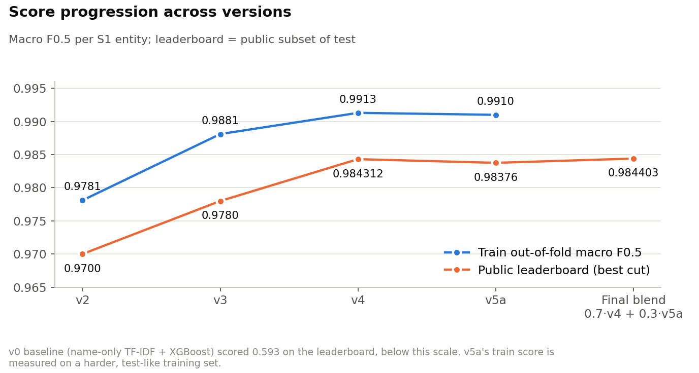
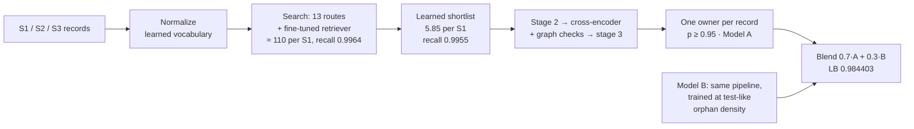
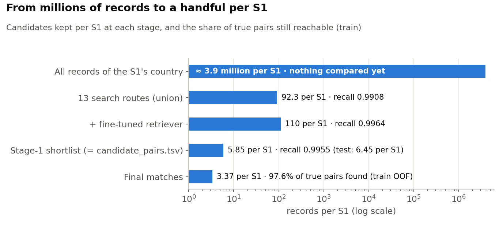

# Business Entity Resolution at Scale: Amazon ML Challenge 2026

Matching **1.7 million businesses** against **10 million noisy records** across the US, India and an unseen
France. The pipeline learns its vocabulary from the data, searches with a fine-tuned retriever, decides with a
leak-free three-stage stacked matcher, and blends two models trained for the test set's shift.

| final public leaderboard | train out-of-fold (Model A) | candidates per S1 | largest model |
|---|---|---|---|
| **0.984403** macro F0.5 | **0.9913** macro F0.5 | **6.45**, keeping 99.55% of true pairs | 560M parameters (MIT) |



## The problem

Each business has one clean record in **Source 1** and zero to eleven corrupted copies in **Sources 2 and 3**:
abbreviations, other scripts, typos, missing addresses, renamed businesses. Mixed in with them are many look-alike
records of other businesses. For every test S1, the task is to return exactly its copies. Scoring is **macro F0.5 per
S1**, so a wrong match costs about three times a missed one.

Constraints: MIT/Apache-2.0 models ≤ 8B, no external data, and France appears only in the test set.
→ [docs/01 · the problem and the data](docs/01-problem-and-data.md)

## How it works



1. **Normalize with a learned vocabulary.** Abbreviations, state codes and native-script words are mapped to the S1
   spelling using rules learned from the true pairs (≈ 2,700 mappings), not hand-written lists.
2. **Search for candidates within each country:** two multilingual e5 embedders in both directions, character-3-gram
   sketches, rare-word and exact keys, and an **e5 retriever fine-tuned on our own pairs**, the biggest recall gain.
3. **Shortlist** with a fast XGBoost: the smallest set per S1 that keeps 99.9% of the found matches.
4. **Decide with three stacked stages:** XGBoost on 101 pair features, a cross-encoder for unsure pairs,
   graph-consistency checks, and a stage-3 stack. Every stacked score is out-of-fold.
5. **Assign each record to one S1** and keep pairs with p ≥ 0.95, a cut set from leaderboard evidence.
6. **Blend** with Model B, the same pipeline trained after hiding 19% of the training S1 so that the training data
   matches the test set's density of look-alikes.

→ [docs/02 · the solution, step by step](docs/02-solution.md) · interactive guides in [`visuals/`](visuals/)



## Results

| version | main idea | train OOF | public LB |
|---|---|---|---|
| v0 | name-only TF-IDF search, XGBoost | — | 0.593 |
| teammate v1 | char-3-gram sketch views, MLP | — | 0.904 |
| teammate, later | | | 0.964 |
| v2 | learned vocabulary, dense search both ways, LightGBM | 0.9781 | 0.9700 |
| v3 | 13 search routes, learned shortlist, ~100 features | 0.9881 | 0.978 |
| v4 = Model A | fine-tuned retriever, cross-encoder, stage-3 stack | **0.9913** | 0.984312 |
| v5a = Model B | v4 trained at test-like orphan density | 0.9910 | 0.98376 |
| **final** | **0.7 · Model A + 0.3 · Model B** | | **0.984403** |

→ [docs/03 · results and analysis](docs/03-results-and-analysis.md) (threshold probes, error analysis, ablations,
blends, negative results)

## Key findings

- **The test set had twice as many look-alikes.** S1 records are identical in train and test, but test has ≈ 42%
  "orphan" records (records with no S1) against 26% in train. Orphans are clean look-alikes that cause 63% of false
  matches, which explained the whole train → leaderboard gap.
- **The leaderboard can measure precision.** The metric averages over S1, so two nested submissions reveal how
  precise the pairs that differ are. This set the cut at 0.95: pairs in the 0.95–0.99 band are ≈ 85% right on test.
- **Fine-tune retrieval on your own pairs.** One contrastively trained retriever beat thirteen hand-designed search
  routes on recall per candidate.
- **Compare models at equal output size.** Judged at a fixed pair count on test-like training data, the blend's
  predicted gain (+0.0001) matched the leaderboard (+0.00009).
- **Learn the vocabulary.** Learned and mined mappings handled abbreviations, nine Indian scripts and the unseen
  France without one hand-written word list.

→ [docs/04 · development journey and lessons](docs/04-development-journey.md)

## Repository

```
├── pipeline/            the final, runnable pipeline (Model A, Model B, auxiliary matcher, blend)
│   ├── src/run.sh       one command: auxiliary matcher → Model A → Model B → blend → submission/
│   └── README.md        how to reproduce, settings, code layout
├── docs/                problem & data · solution · results · journey · infrastructure · literature
│                        + submission-methodology.md (the write-up submitted to the organizers)
├── versions/            v0 → v6 and the teammate's versions: notes, reports and metrics per version
├── eda/                 the four exploratory analyses and their reports
├── analysis/            post-hoc scripts (leaderboard-difference precision, probes, blends, votes)
├── assets/              charts used in the docs (drawn by scripts/make_figures.py)
├── visuals/             interactive HTML guides (pipeline flow, plain + technical tour, the maths)
├── results/scores.csv   every score in one table
└── scripts/             make_figures.py
```

Every top-level folder has its own README describing its contents.

## Reproduce

Put the competition data in `dataset/{train,test}/` at the repository root (it is git-ignored), then:

```bash
pip install -r pipeline/requirements.txt      # after installing the CUDA build of PyTorch
SMOKE=1 bash pipeline/src/run.sh               # 10k-S1 sample of the whole chain (≈ 30 min)
bash pipeline/src/run.sh                       # full run on one GPU (≈ 13–15 h) -> pipeline/submission/
```

| how | needs | time |
|---|---|---|
| final blend only (`pipeline/src/run_final.py`): verified to rebuild the submitted file byte for byte | numpy + pyarrow, the two models' test scores | ≈ 3 min |
| full pipeline on your own machine (`pipeline/src/run.sh`) | Linux/WSL2, 1 NVIDIA GPU ≥ 24 GB, 256 GB RAM, 400 GB disk | ≈ 13–15 h |
| full pipeline on AWS SageMaker (`pipeline/src/sagemaker/`) | your AWS account: GPU training quota, S3 bucket, execution role, AWS CLI | ≈ 13–15 h GPU |

Step-by-step commands for all three: [docs/05 · infrastructure and reproducibility](docs/05-infrastructure-and-reproducibility.md).

## Team

**Team 4Miracles**: Shreyansh Gupta (lead), Vedant Singhal, Kumaradithya Chadalavada, Jithin Shaji.

Literature that shaped the solution: [docs/06](docs/06-literature.md). Built on `intfloat/multilingual-e5`, XGBoost,
LightGBM, PyTorch, sentence-transformers, polars, RapidFuzz and anyascii.

## My Contribution

As part of Team 4Miracles, I contributed to the experimentation and evaluation of different modelling approaches for business entity resolution. My work involved:

- Experimenting with multiple model architectures and approaches for entity matching.
- Comparing model performance and evaluating different configurations.
- Contributing to discussions and analysis that helped select the final modelling approach.
- Collaborating with the team to build a scalable entity-resolution pipeline for matching noisy business records.

The project achieved a public leaderboard score of **0.984403 Macro F0.5**.

*This was a collaborative team project; the repository contains the combined work of all four members.*

## License

Code: [MIT](LICENSE). The competition data belongs to the organizers and is not part of this repository.
