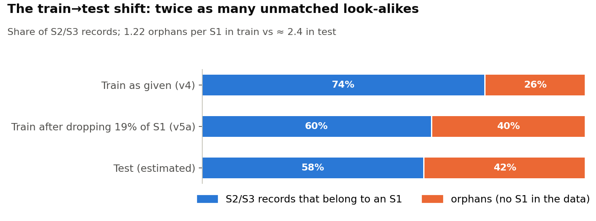

# 1. The problem and the data

## The task

Three sources describe the same businesses:

| source | role | example |
|---|---|---|
| **S1** | the clean reference record of each business | `Shree & Sons Pvt Ltd · Plot No: 63, M V P Colony, Visakhapatnam, Andhra Pradesh` |
| **S2**, **S3** | noisy copies, plus unrelated records | `Shree & Sóns Pvt Ltd · Plot No: 63, Vishakhapatnam, AP` |

For every S1 entity in the test set, return **all** of its S2/S3 copies, and nothing else. Two files are submitted:

- `matching_results.tsv`: one row per S1 with its matched S2/S3 ids (this file is scored);
- `candidate_pairs.tsv`: the exact candidate set the final model scored (the blocking output). Every match must be a
  candidate, and a smaller candidate set per S1 was preferred in the final review.

### Metric: macro F0.5 per S1

For each S1 entity `a` with predicted set `M(a)` and true set `T(a)`:

```
F0.5(a) = 1.25·TP / (1.25·TP + 0.25·FN + FP)        and F0.5(a) = 1 when T(a) = M(a) = ∅
score   = mean of F0.5(a) over all 1,732,544 test S1
```

F0.5 weighs precision over recall. For an S1 with three true matches, one wrong extra match drops it to 0.79, while one
missed match drops it to 0.91. An S1 with no matches scores 1.0 only if the prediction is empty.

### Rules that shaped the design

- Final model under an MIT or Apache-2.0 licence, at most 8B parameters.
- Only the provided training data: no external databases, APIs, geocoding or data augmentation from the internet.
  We also chose not to use hand-written word lists (states, street types, legal forms): every mapping is learned from
  the data.
- `country` is an open set. **France appears only in the test set**, so nothing may be hard-coded to US/India.

## Data at a glance

| | S1 | S2 | S3 | true pairs |
|---|---|---|---|---|
| Train | 2,206,821 | 5,034,616 | 5,285,603 | 7.60M (3.46 per S1; 5.6% of S1 have none) |
| Test | 1,732,544 (US 663,106 · India 809,986 · France 259,452) | 4,887,273 | 5,082,316 | hidden |

**Structure we could exploit** (train ground truth, `eda/reports/01_profile.md`):

| fact | value | consequence |
|---|---|---|
| true pairs across countries | 0 of 7.6M | search only within a country |
| S2/S3 records matched to more than one S1 | 0 | **each record belongs to at most one S1**, a precision lever |
| S1 with no match | 5.6% | the empty answer must be a real option |
| matches per S1 | mean 3.46, p90 6, max 11 | several copies per source are normal |
| S2/S3 records that match nothing | 26% | many decoys |
| duplicate S1 names | 31% | the name alone is ambiguous; name + address is unique |

## How the copies are corrupted

Measured on the true train pairs:

| noise | examples / share |
|---|---|
| abbreviations | `st`/`street`, `pvt`/`private`, `up`/`uttar pradesh`, `new york`/`ny` |
| state formats differ by source | US S1/S2 `TX`, S3 `Texas`; India S1 full name, S2 local script `महाराष्ट्र`, S3 code `MH` |
| non-Latin script (India) | 23.5% of S2 names, 13% of S3 names (Devanagari, Bengali, Tamil, Telugu, Kannada, …) |
| legal and generic words added, dropped or swapped | `llc`, `ltd`, `services`, `center`, `partners` |
| encoding and OCR noise | mojibake (`é`), zero-width characters, digits for letters (`8lack`) |
| extra parts | web-style names (≈4%), aliases (`dba`, `aka`, brackets), honorifics, `NULL` tokens (2–3%) |
| missing or changed address parts | no address on ≈3% of S2/S3 records; house numbers dropped, truncated or changed |
| unrelated names | 3–6% of true pairs share almost no name words (trade names, initials, domains); their address still matches |

**What separates a match from a look-alike.** Against name-similar hard negatives, address agreement is by far the
strongest single signal (address token-set AUC 0.969, house-number Jaccard 0.905; best name metric only ≈ 0.79),
because different businesses share names. The hardest negatives are near-twins: the same name at the neighbouring
house number (`… 1530 Windrose Bend` vs `… 1535 Windrose Bend`).

**Candidate search studies** (`eda/reports/03_blocking.md`, `04_embeddings.md`):
- Exact shared-key blocking reaches 0.970 recall only with about 1,200 candidates per S1, and address keys explode for
  France and India. Scored top-k retrieval is needed rather than raw key blocks.
- Off-the-shelf `multilingual-e5-small` on `name | address` reaches recall@50 of 0.95 (India) and 0.98 (US); name-only
  embeddings are nearly useless (0.56 / 0.74). Cosine similarity is a good retrieval signal but a poor decision score:
  a true pair beats the S1's best wrong neighbour only 64% of the time.

## The train → test shift



The key discovery of the project (details: [`versions/v4/reports/train-vs-test-shift.md`](../versions/v4/reports/train-vs-test-shift.md)):

| | train US | test US | train India | test India | test France |
|---|---|---|---|---|---|
| S2+S3 records per S1 | 4.67 | 5.76 | 4.68 | 5.82 | 5.53 |
| orphan share (records with no S1) | 26.0% | ≈ 41–42% | 26.0% | ≈ 42% | ≈ 38% |
| orphan records per S1 | 1.22 | ≈ 2.4 | 1.22 | ≈ 2.4 | ≈ 2.1 |

- **S1 records are identical** in train and test. Only the share of *orphans* (S2/S3 records whose S1 is absent)
  changes.
- **Orphans are clean, complete records.** In train, 0.3% of orphans lack an address against 4.7% of matched records.
  The test S2/S3 profile equals the train mixture at 41–42% orphans, measured independently from two signals (empty
  addresses, web-style names) for both US and India. Test looks like train with ≈ 19% of S1 removed and their records
  kept.
- **Why it matters:** orphans resemble a nearby S1 (same chain, neighbouring address), and they already cause 63% of
  the false matches on train. On test the model meets twice as many, so a decision threshold tuned on train is too
  loose. Section [3](03-results-and-analysis.md) shows the leaderboard confirming this, and Model B
  ([02](02-solution.md)) trains at the test's orphan density.

## France: an unseen country

France has no training labels. Its abbreviations (`r` → `rue`, `bd` → `boulevard`, `imp` → `impasse`) and legal or
generic words (`sarl`, `cie`, `groupe`, `développement`) never appear in train, and 34% of French S1 share their exact
name with another S1 (`bordeaux club sarl` appears 205 times). On test it carries 2–3× more uncertain pairs per S1 than
US or India.
