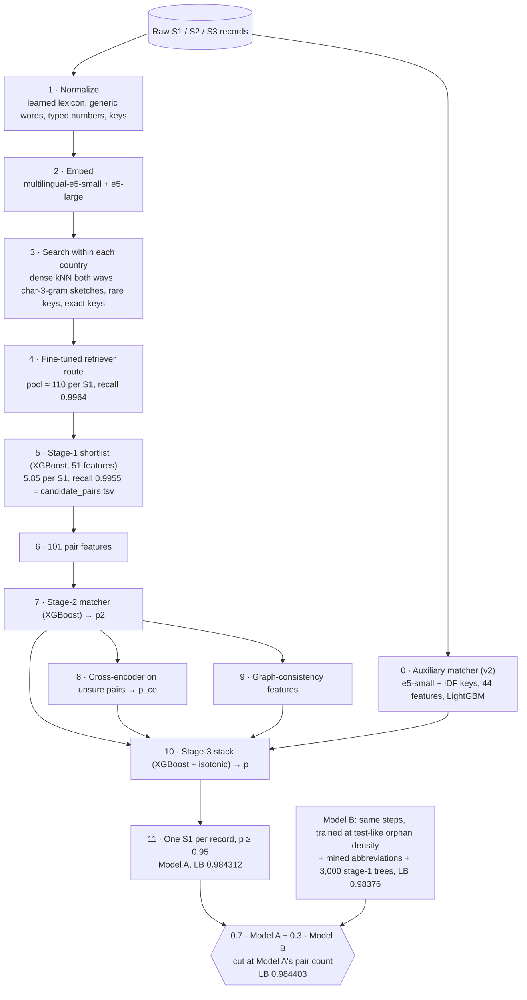
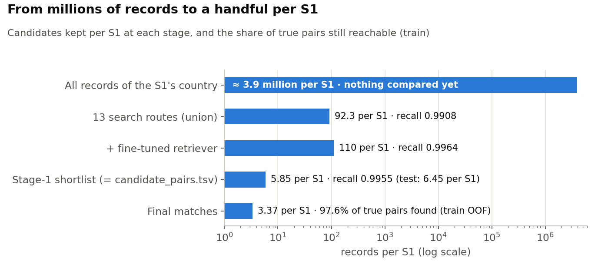
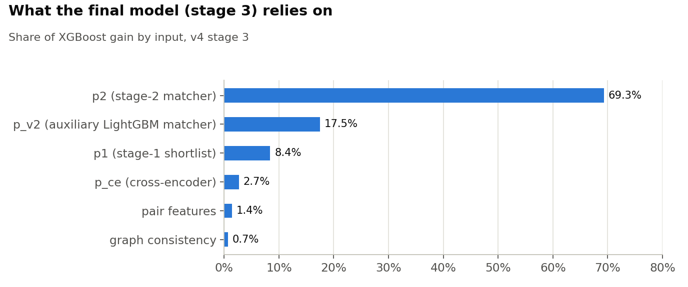

# 2. The solution

One pipeline, trained two ways and blended. **Model A** (`run_v4.py`) is the main pipeline. **Model B**
(`run_v5.py`) is the same code with three training changes. The submission is `0.7 · p_A + 0.3 · p_B`. The
as-submitted write-up with every setting is [`submission-methodology.md`](submission-methodology.md). Interactive
versions of this page are in [`../visuals/`](../visuals/).





## Design principles

1. **Learned, not listed.** Every vocabulary mapping comes from the data: a lexicon learned from the true train
   pairs, and, in Model B, abbreviations mined from the raw records. There are no hand-written lists of states,
   street types or legal forms.
2. **High recall first, then precision.** The search keeps 99.64% of true pairs, and the shortlist keeps 99.55% at
   5.85 candidates per S1. Everything after that is about rejecting look-alikes.
3. **Leak-free stacking.** Every S1 is assigned a fold, `hash(S1 id, 13) mod 5`, used by every stage. Each score fed to
   a later stage is out-of-fold, so it behaves on train the way it will on test.
4. **One owner per record.** The ground truth never gives an S2/S3 record two S1s, so each record goes only to the S1
   that wants it most.
5. **Country is never a feature.** It only limits the search, so France goes through exactly the same code.

## Model A, step by step

| step | code | what it does | result (train) |
|---|---|---|---|
| **0 · auxiliary matcher** | `pipeline/src/v2/` | A simpler, independent matcher: e5-small search (25 per S1 + 5 S1 per record) + IDF keys, 44 features, LightGBM, isotonic calibration. Its out-of-fold score `p_v2` is one stage-3 input | macro F0.5 0.9781 |
| **1 · normalize** | `ber/prepare.py`, `text.py`, `lexicon.py` | Mojibake and zero-width repair, alias split, learned lexicon (keep `u → v` when seen ≥ 20 times and consistent in ≥ 50% of cases; ≈ 2,000 name + 700 address mappings), `anyascii` for remaining non-Latin words, per-country generic words (≥ 1% of names) removed to form the core name, consonant skeleton, metaphone, typed numbers, uniqueness counts | |
| **2 · embed** | `ber/embed.py` | `multilingual-e5-small` (118M) and `-large` (560M) on `name \| address`, fp16, ≤ 64 tokens. The two are complementary: large is best on native script, small on records without an address | |
| **3 · search** | `ber/block.py`, `sketch.py` | Within each country: top 25 records per S1 and top 5 S1 per record for each embedder (exact GPU search); character-3-gram TF-IDF count-sketched to 256 dims for name and address; IDF-weighted rare keys (top 20); 6 exact keys capped at 10 S1 / 50 records | recall 0.9908 at 92 per S1 |
| **4 · retriever** | `ber/retriever.py` | e5-small fine-tuned on the train pairs (InfoNCE with in-batch negatives, romanized copies of native script as extra positives), cross-fitted by S1 half; adds top 10 per S1 and top 3 S1 per record | **recall 0.9964** at 110 per S1 |
| **5 · shortlist** | `ber/stage1.py` | XGBoost on 51 cheap features, out-of-fold over the whole pool; keeps rank ≤ 10 and p1 ≥ 0.003, the smallest rule keeping 99.9% of the pool's recall | **recall 0.9955 at 5.85 per S1** |
| **6 · features** | `ber/features.py` | 101 pair features: name and address similarities (RapidFuzz), house-number relation (equal / truncated / one-digit edit / different), rarity of shared words, phonetic and typo checks, retrieval ranks, and *listwise* rank and gap against the other candidates of the same S1 and the same record | |
| **7 · stage 2** | `ber/train.py`, `learner.py` | XGBoost on GPU (lr 0.05, ≤ 5,000 trees, early stopping, depth 9), isotonic calibration → `p2`; per-S1 "has any match" model | macro F0.5 0.9888 |
| **8 · cross-encoder** | `ber/crossenc.py` | `multilingual-e5-small` + 1-logit head reads both records together, only for unsure pairs (0.02 ≤ p2 ≤ 0.98); 2-fold cross-fitted → `p_ce` | |
| **9 · graph** | `ber/graph.py` | Does another S1 want this record more? Does it resemble the S1's strong siblings (p2 ≥ 0.5), including those from the other source? | |
| **10 · stage 3** | `ber/stage3.py` | XGBoost on 105 inputs: the 101 pair features minus 5 candidate-count features, plus `p2`, `p_ce`, 6 graph features (3 count-based ones dropped) and `p_v2`; counts whose meaning changes with candidate density are left out. Same folds; isotonic → final `p` | **macro F0.5 0.9913** (US 0.9908, India 0.9921) |
| **11 · decision** | `ber/decide.py` | Each S2/S3 record goes to its highest-p S1; keep pairs with p ≥ 0.95 | LB **0.984312** |



### Why the threshold is 0.95 and not the train optimum

On train the best cut is about 0.70. On test, with twice as many look-alike orphans ([section 1](01-problem-and-data.md)),
the same scores are over-confident. Leaderboard probes on fixed scores settled it: Model A scores 0.983 with its
train-tuned rule, **0.984312 at 0.95** and 0.980 at 0.99. Comparing those scores also measures how precise the pairs
between two cuts are on test: the 0.95–0.99 band is about 85% right, against 95% on train
([section 3](03-results-and-analysis.md#reading-precision-from-the-leaderboard)).

## Model B: what is added

Same code (`run_v5.py` sets three switches) and the same candidate pool. Model B therefore scores exactly the same
shortlist.

1. **Train at the test's orphan density** (`ber/s1drop.py`). After the search, 19% of train S1 are removed by a hash of
   their id (2,206,821 → 1,786,233). Their S2/S3 records stay as orphans, the pool shrinks from 243.8M to 197.3M
   pairs, and reverse-search ranks are recomputed among the remaining S1. Stages 1–3 then learn to reject look-alikes
   as often as test requires.
2. **Mine each country's abbreviations from the records** (`ber/mining.py`, no labels). Records sharing a house number
   and a rare word are almost surely the same place. Inside such groups, a word missing from one record that
   abbreviates a word in the other (same first letter, letters in order) is counted. Frequent, consistent pairs are kept
   (≥ 30 times, ≥ 50%), e.g. `r → rue`, `bd → boulevard`, `ets → etablissements`. This gives France a vocabulary without
   any labels.
3. **3,000 stage-1 trees**: Model A's stage 1 had stopped at its 1,500-tree cap in every fold.

Alone, Model B scores 0.98376 on the leaderboard (train 0.9910 on its harder, test-like training set). It is more
conservative than Model A and makes different mistakes.

## The submitted blend

```
p = 0.7 · p_A + 0.3 · p_B                      (a pair one model did not score counts as 0 for that model)
each S2/S3 record → its highest-p S1
t = the n-th largest winning p, with n = Model A's pair count at p ≥ 0.95     → t = 0.9157, 5,836,213 pairs
```

Holding the pair count fixed means the blend can only swap Model A's weakest pairs for stronger ones, never become
looser or stricter. The weights were chosen on the 1,782,911 train S1 that Model B kept (test-like orphan density),
comparing 14 weightings and three voting rules at that same pair count: 0.7/0.3 was best, at 0.99031 against Model A's
0.99021. On the leaderboard the blend gained **+0.00009** (0.984312 → **0.984403**), matching the training estimate.
`pipeline/src/run_final.py` reproduces the uploaded file byte for byte from the two models' test scores.

## Models and libraries

| component | licence | size |
|---|---|---|
| `intfloat/multilingual-e5-small`, plus the fine-tuned retriever and cross-encoder built from it | MIT | 118M |
| `intfloat/multilingual-e5-large` | MIT | 560M |
| XGBoost (stages 1–3, has-any-match) | Apache-2.0 | |
| LightGBM (auxiliary matcher) | MIT | |
| PyTorch, sentence-transformers, transformers, polars, pyarrow, numpy, scipy, scikit-learn, RapidFuzz, jellyfish, anyascii, FAISS | BSD / Apache-2.0 / MIT / ISC | |

All text normalization, including the auxiliary matcher, transliterates remaining non-Latin words with `anyascii`
(ISC).
