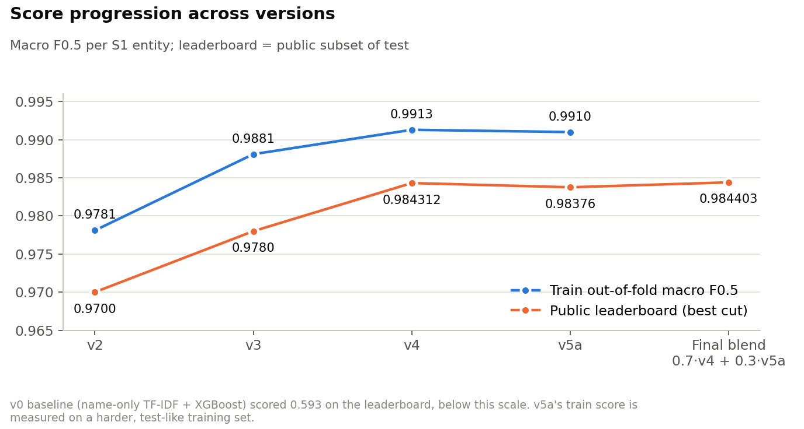
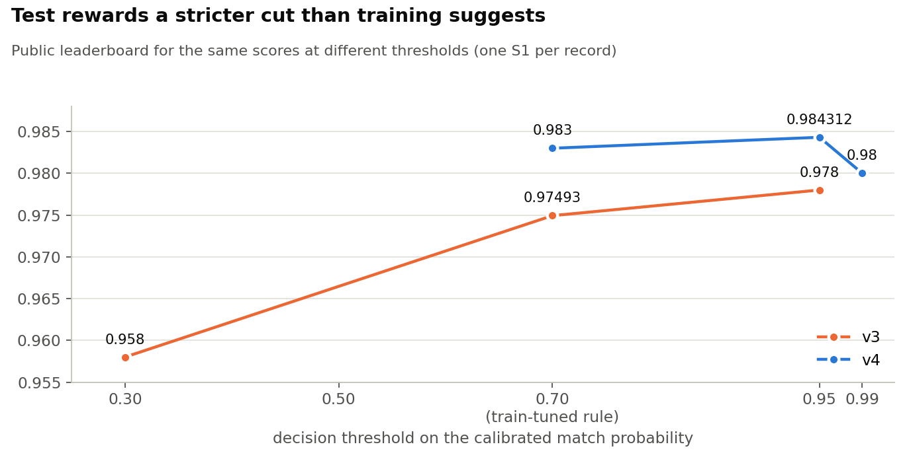
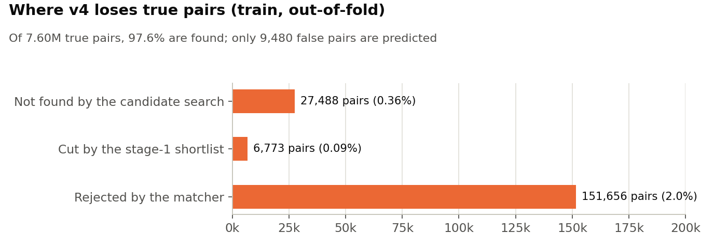
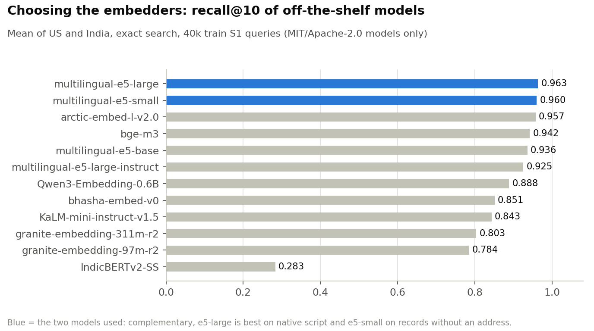
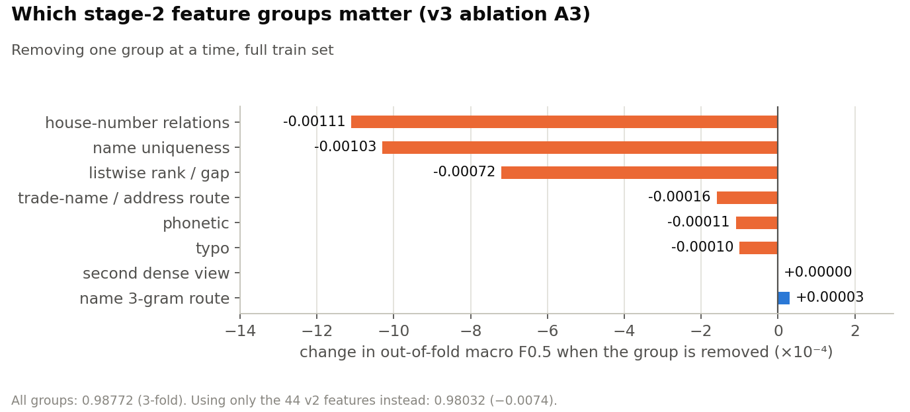
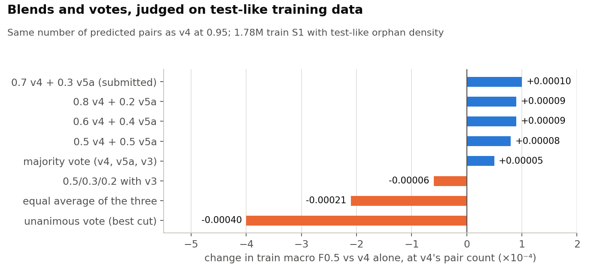

# 3. Results and analysis

All numbers come from the run reports in [`../versions/`](../versions/) and the leaderboard (LB). Train scores are
out-of-fold macro F0.5 over all train S1 (5 folds grouped by S1). The LB is the public subset of the test set.
Machine-readable: [`../results/scores.csv`](../results/scores.csv).

## Leaderboard history

| version | what it is | decision | train OOF | public LB |
|---|---|---|---|---|
| v0 | name-only TF-IDF search, 9 features, XGBoost | one threshold, pair-level F0.5 | (leaky split) | 0.593 |
| teammate v1 | char-3-gram sketch views + FAISS, 33 features, MLP | one threshold | 0.955 (own hold-out, 30% sample) | 0.904 |
| teammate, later version | (code not archived) | | | 0.964 |
| v2 | learned lexicon, e5-small both ways + IDF keys, 44 features, LightGBM | one owner, t = 0.65 | 0.9781 | 0.9700 |
| v3 | 13 search routes, learned shortlist, ~100 features, XGBoost | train-tuned rule | 0.9881 | 0.97493 |
| | | fold-consistent test scoring | 0.9881 | 0.974654 |
| | | t = 0.30 | | 0.958 |
| | | t = 0.95 | | 0.978 |
| v4 = Model A | + fine-tuned retriever, cross-encoder, graph features, stage-3 stack | train-tuned rule (expected F0.5) | **0.9913** | 0.983 |
| | | **t = 0.95** | | **0.984312** |
| | | t = 0.99 | | 0.980 |
| | | t = 0.95, number-conflict band pairs dropped | | 0.984 |
| | | t = 0.95, no-address band pairs dropped | | 0.983 |
| v5a = Model B | v4 trained at test orphan density + mined abbreviations + 3,000 trees | t = 0.95 | 0.9910 (harder train) | 0.98376 |
| | | t = 0.93 or 0.70 | | ≈ 0.983 |
| **final** | **0.7 · v4 + 0.3 · v5a** | **cut at v4's pair count (t = 0.9157)** | +0.0001 vs v4 at equal count | **0.984403** |

Scores by country (train OOF): v2 US 0.9795 / India 0.9760; v3 0.9881 / 0.9881; v4 0.9908 / 0.9921; v5a
0.9905 / 0.9917.

## Test needs a stricter cut than train

With the same scores, the leaderboard rose as the cut became stricter, well past the train optimum (≈ 0.70): v3 from
0.958 (t 0.30) to 0.978 (t 0.95), and v4 peaked at 0.95. The cause is the train → test orphan shift
([section 1](01-problem-and-data.md#the-train--test-shift)): test has twice as many clean look-alike records, so the
calibrated probabilities are over-confident there.

### Reading precision from the leaderboard

The metric is a mean over S1, so two submissions that differ only on a known set of pairs tell how precise those pairs
are on test. Take file B as a subset of file A. Assume each extra pair in A is right with probability q, compute the
expected per-S1 F0.5 difference, and solve `N · (LB_A − LB_B) = Σ E[ΔF0.5](q)` for q
([`analysis/lb_difference_precision.py`](../analysis/lb_difference_precision.py)).

| pairs in A but not in B | extra pairs | implied precision on test |
|---|---|---|
| v4 0.95–0.99 band (t 0.95 vs t 0.99) | ≈ 131k | ≈ 0.85 (train: 0.95) |
| v4 rule vs t 0.99 | 202,656 | ≈ 0.75 |
| v4 between the rule cut and 0.95 | 71,896 | ≈ 0.60 |
| v4 band pairs without an address | | ≈ 0.90 |
| v4 band pairs whose house numbers conflict | | ≈ 0.72 |
| v3 t 0.30 vs t 0.95 | 433,550 | ≈ 0.45 |

Adding a pair pays off only above ≈ 0.70 precision, and filling an empty S1 above 0.50. So 0.95 is the right cut, and
no remaining band group (no-address, number conflicts) is wrong often enough to remove by rule. These estimates were
made during the challenge using v4 t 0.95 = 0.98414; with the exact 0.984312 the 0.95–0.99 band comes out slightly
more precise and the rule-to-0.95 pairs slightly less, which leaves the conclusions unchanged.

## Where the errors are

**v4 on train** ([`oof-errors-stage3.md`](../versions/v4/reports/oof-errors-stage3.md)): 97.6% of 7.60M true pairs
found, 9,480 false pairs. The misses concentrate on records **without an address** (39% of their true pairs missed:
name-only evidence, often a name shared by several S1), **without a house number** (12.9%), and names shared by 4+ S1.
63% of the false pairs go to orphan records.

**v4 on test** ([`test-diagnosis.md`](../versions/v4/reports/test-diagnosis.md), label-free estimates): of about
27.5k S1-units of loss, ≈ 25% are false matches (mostly in the 0.95–0.99 band) and ≈ 75% are misses (≈ 4.9k S1 wrongly
left empty, ≈ 3k units from true pairs cut at 0.95, the rest never predicted). France carries 0.23 uncertain pairs per
S1 against 0.09–0.11 for India and US.

**v2 error taxonomy**, which drove the v3 features ([`versions/v2/reports/`](../versions/v2/reports/)):

| error | train pairs | v3 response |
|---|---|---|
| E1 record without address (missed) | 192,864 | name-uniqueness features, name 3-gram route |
| E2 house number differs (missed) · E7 near-twins (false) | 70,972 · 14,184 | number relation: equal / truncated / one-digit edit / different |
| E3 trade names (missed) · E8 same address, other business (false) | 43,778 · 7,072 | address 3-gram route, co-location counts |
| E4 native script (missed; 22,373 by the search) | 25,644 | consonant skeleton, metaphone, exact core keys |
| E5 typos near the threshold (missed) | 22,324 | invented-word (garble) and one-edit features |
| E6 no-address false merges | 19,237 | uniqueness, listwise gaps |

## Ablations

**Embedders (v3 A0, 14 models, 4 rounds).** No MIT/Apache model beat e5 on these short `name | address` strings.
e5-large wins overall and on native script (recall@10 0.955 vs 0.891 for e5-small); e5-small wins on records without
an address (0.736 vs 0.655) and trade names. Both are used as separate views. Decoder embedders (Qwen3, KaLM) were
weaker and 20–40× slower; Indic-specific models did not beat e5 on native script. Approximate IVF search lost 2–18
recall points against exact search at practical `nprobe`, so exact GPU search is used at this size.

**Feature groups (v3 A3).** House-number relations, name uniqueness and listwise rank/gap features matter most.
Together the new groups add +0.0074 over the 44 v2 features. Other ablations: XGBoost 0.9877 ≈ LightGBM 0.9876 (A4);
decision rules expected-F0.5 with has-any-match 0.9881 > expected-F0.5 0.9880 > threshold 0.9879 (A5).
**Leave-one-country-out (A6): US → India 0.9548 (−0.033), India → US 0.9736 (−0.014)**: weak transfer to an unseen
country, the France risk.

**Fine-tuned retriever (v4).** One retriever fine-tuned on our own pairs reached recall 0.9946 at 31 pairs per S1 on
its own, beating the whole v3 pool of 13 routes (0.9908 at 92 per S1). It was the single biggest recall lever.

## Look-alike patterns: same address, one name word changed

Measured on a 10% sample of train S1 against the ground truth, among shortlisted candidates:

| train, same house number | US: true share | India: true share |
|---|---|---|
| one name word swapped | 96.8% | 92.3% |
| no shared name word | 84.6% | 80.5% |
| one word swapped, **different** house number | 20.1% | 53.0% |
| record without address, same name | 21.0% | 21.5% |

A swapped word at the same address is usually generator noise: the swapped-in word is generic (`center`, `ltd`,
`services`, `partners`, `incorporated`). Real look-alikes swap in distinguishing words (`public`, `group`, `holdings`,
`ventures`, `industries`, `exports`). Our model accepts these patterns at almost exactly the true rates on train (e.g.
US one-word swap 96.7%). On test it accepts the same-address, one-word-swap pattern at 94.4% (US) and 85.1% (India),
but only **68.8% for France**, where the swapped words are French generic or legal words (`groupe`, `cie`,
`développement`) it never saw in training. Test also has 47–83% more different-number look-alike candidates per S1,
consistent with the orphan shift.

## Blends and votes

All variants were held at v4's pair count and judged on the train S1 that v5a kept (test-like orphan density).
Weighted blends of v4 and v5a gain ≈ +0.0001. Any meaningful weight on v3 hurts, and equal averaging and unanimous
votes are worse than v4 alone. On the leaderboard the chosen 0.7/0.3 blend gained +0.00009, matching the training
estimate (reports: [`versions/v5/reports/`](../versions/v5/reports/)).

## What did not help

| idea | evidence | verdict |
|---|---|---|
| fold-consistent test scoring (v3) | LB 0.974654 vs 0.97493 | no gain; the LB gap is data shift, not a scoring mismatch |
| drop band pairs with conflicting house numbers | LB 0.984 vs 0.984312, pairs ≈ 0.72 precise | at break-even |
| drop band pairs without an address | LB 0.983, pairs ≈ 0.90 precise | hurts |
| add exact-copy "twins" of cluster members | train −0.0019 (adds at 13.7% precision) | hurts: the copies are mostly orphans |
| add exact normalized-key pairs missed by the model | break-even 0.74; estimated mostly decoys | not submitted |
| classical Fellegi–Sunter (EM, no labels) as a second judge | disagrees with v4 mostly where v4 is right | not used |
| blatant-mismatch filter | only 196 of 5.84M pairs flagged, fewer than true pairs alone produce | nothing to remove |
| shortlist at 99.99% instead of 99.9% of pool recall | at most 0.09% more true pairs, all hard | not worth a rerun |
| v5a alone instead of v4 | LB 0.98376 | more conservative than v4; useful only in the blend |

## How noisy is the public leaderboard?

The public LB scores a random share of the test S1. From per-S1 score variation, the full-test score lies within about
±0.0001–0.0003 (95%) of the public score for public shares of 10–50%. A difference between two of our files needs to
exceed roughly 0.0003–0.0005 to be clearly real. The 0.95 cut (+0.0013 over the train rule) passes that easily. The
blend's +0.00009 is small on its own, but it was predicted in advance from training data.
